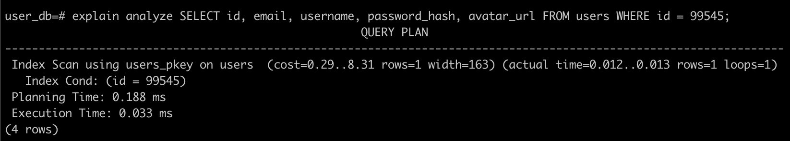

### Анализ полученных результатов

Выходные результаты отражают:
- количество запущенных потоков и соединений
```
_ threads and _ connections
```

- Latency (Время отклика) и Req/Sec = RPS(Количество запросов) в секунду, отражающие параметры функции Гаусса,
где Avg - среднее, Sydev - стандартное отклонение, Max - максимальное, +/- Stdev -  процент запросов в пределах стандартного отклоения
```
Thread Stats   Avg      Stdev     Max   +/- Stdev
Latency        _ms       _ms      _ms     _%
Req/Sec        _         _        _       _%
```

- количество переданных запросов за промежуток времени, переданные данные, пропускная способность
```
_ requests in _s, _MB read
Requests/sec:   _
Transfer/sec:   _KB
```
#### Выходные результаты после выполения ```POST``` запроса

- Средняя задержка: 1.93s - достаточно большое, поскольку ходим в несколько сервисов
- RPS: 103.00

Средняя задержка соответсвует допустимым значениям в рамках работы приложения, поскольку регистрация - процесс не самый важный с точки зрения скорости.
В данном случае значение RPS низкое
То есть при заполнении БД в целом нагрузка была небольшой.

#### Выходные результаты после выполения ```GET``` запроса

- Средняя задержка: 452.87ms
- RPS: 219.89

Средняя задержка соответсвует допустимым значениям в рамках работы приложения.
Значение RPS удовлетворяет требованиям производительности.

#### Оптимизация
Оптимизация как таковая не нужна, поскольку итак используется index scan


Можно в качестве дополнительных оптимизаций использовать реплицирование или партицирование
Эти меры помогут увеличить скорость чтения, а также дополнительно повысят надежность хранилища
